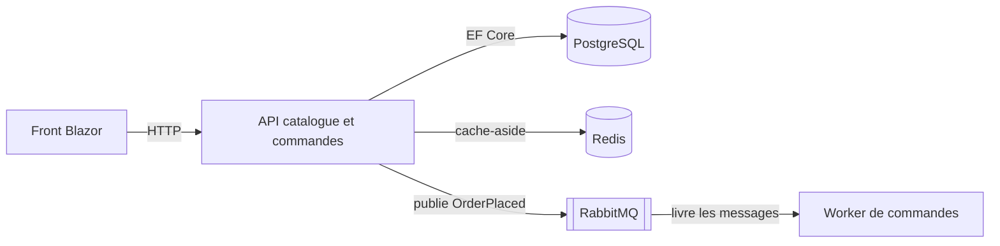

# ShopLite — Démo d'architecture distribuée avec Aspire


Mini-boutique en ligne réalisée pour apprendre et démontrer une architecture distribuée
en .NET 10, orchestrée avec [Aspire](https://aspire.dev).

## Architecture



## Stack technique

| Domaine | Technologies |
|---|---|
| Orchestration | Aspire (AppHost, ServiceDefaults, dashboard) |
| Backend | ASP.NET Core Minimal API, EF Core, Worker Service |
| Frontend | Blazor |
| Données | PostgreSQL, Redis |
| Messagerie | RabbitMQ |
| Observabilité | OpenTelemetry (traces, logs structurés, métriques) |
| Tests | xUnit, Aspire.Hosting.Testing |
| CI | GitHub Actions |

## Fonctionnalités

- **Catalogue** avec cache Redis (pattern cache-aside et invalidation à l'écriture)
- **Commandes asynchrones** : réponse `202 Accepted` immédiate, traitement en arrière-plan
  par un Worker, confirmation manuelle des messages (ack)
- **Observabilité** : traces distribuées de bout en bout, logs structurés,
  métrique métier `shoplite.orders.processed`
- **Health checks** sur l'API et ses dépendances
- **Tests d'intégration** qui démarrent la véritable infrastructure (conteneurs compris)
- **CI** : compilation et tests à chaque push et pull request

## Lancer le projet

**Prérequis :** SDK .NET 10, Docker Desktop, [CLI Aspire](https://aspire.dev)

```bash
git clone https://github.com/lletierce/shoplite-aspire.git
cd shoplite-aspire/src
aspire run
```

Le dashboard Aspire s'ouvre automatiquement, avec les liens vers le front et l'API.

## Lancer les tests

```bash
cd src
dotnet test
```

Docker doit être démarré : les tests lancent PostgreSQL, Redis et RabbitMQ dans des conteneurs.

## Choix techniques

**Pourquoi Aspire plutôt que Docker Compose ?**
Docker Compose permet de lancer plusieurs conteneurs ensemble. Aspire va plus loin : l'architecture
est décrite en C#, il lance aussi bien les conteneurs que les projets .NET (avec le débogage), et il
injecte automatiquement les chaînes de connexion et les adresses des services. Les ServiceDefaults
ajoutent à chaque service les traces, les logs structurés et les health checks, consultables dans
le tableau de bord.

**Pourquoi une file de messages pour les commandes ?**
Quand un utilisateur passe une commande, l'API valide la demande, publie un message dans RabbitMQ et
répond immédiatement (`202 Accepted`), sans attendre la fin du traitement. Le Worker traite ensuite
les messages à son rythme. Cela améliore la réactivité, absorbe les pics de charge, et aucune commande
n'est perdue si le Worker est indisponible : les messages attendent dans la file, et un message non
confirmé est redistribué.

**Pourquoi un cache sur le catalogue ?**
Le catalogue est surtout consulté et rarement modifié : le mettre en cache réduit les appels à la base
et améliore les temps de réponse. Redis est un cache partagé, donc tous les exemplaires de l'API voient
les mêmes données, contrairement à un cache en mémoire. Pour limiter les données périmées, l'entrée du
cache expire au bout de 5 minutes et elle est invalidée à chaque ajout de produit. Ce n'est pas parfait,
c'est un équilibre entre performance et fraîcheur des données.

**Pourquoi des tests d'intégration ?**
Les tests unitaires vérifient chaque élément isolément. Or ce projet contient peu de logique métier et
beaucoup d'assemblage entre services : les bugs importants, comme une invalidation de cache oubliée,
n'apparaissent que lorsque les composants fonctionnent ensemble. Les tests démarrent donc la véritable
infrastructure avec `Aspire.Hosting.Testing` et vérifient le comportement de l'API avec PostgreSQL
et Redis.

## Limites connues et pistes d'amélioration

- L'API expose directement l'entité `Product` : elle devrait renvoyer un DTO
- Le schéma de base est créé par `EnsureCreated` au lieu de migrations EF Core
- L'état des commandes n'est pas suivi (pas de `GET /api/orders/{id}`)
- Pas de gestion des échecs de traitement (nouvelles tentatives, dead-letter queue)
- Une panne de Redis rend l'API indisponible (pas de dégradation gracieuse)
- Chaque test d'intégration redémarre toute l'infrastructure (une fixture partagée l'accélérerait)
- Le traitement des commandes par le Worker n'est pas couvert par les tests
